

  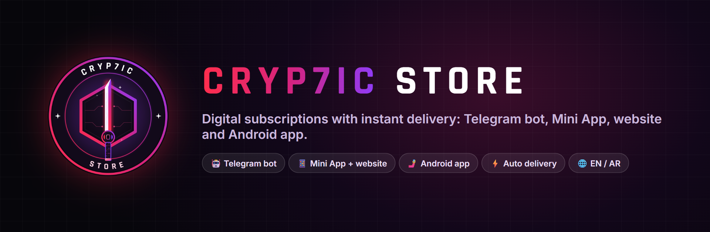

  
  

  
  
  
  
  

**Cryp7ic Store** is a production platform for selling digital subscriptions and keys with instant,
automatic delivery. It runs as a Telegram bot, a Telegram Mini App, a website and an Android app,
all on one back end, with a Binance Pay wallet built in.

**This repo is a showcase.** The source is private. The platform is available to businesses as a
white-label store.

  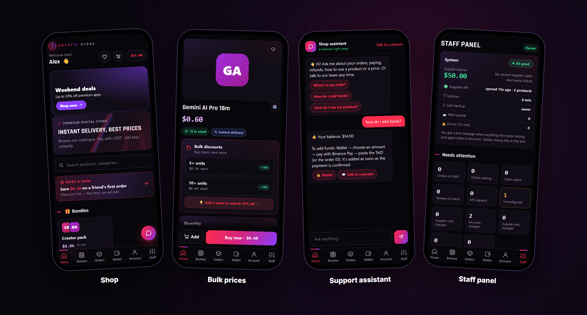

---

## 🤝 For businesses: launch your own store

Sell digital products under **your own brand** without building anything.

- 🤖 **Your own Telegram bot store** on your own subdomain, with your name, logo and prices
- 📦 **Ready catalogue** from connected suppliers, delivered automatically to your customers
- 💰 **Wallet and Binance Pay (USDT)** built in, with every payment verified
- 🛠 **Staff panel** for orders, stock, tickets and broadcasts
- 🌍 **English and Arabic** out of the box
- 🔌 **Reseller REST API with webhooks** if you'd rather plug into your own system

  <a href="https://t.me/EXModder"><b>Message @EXModder on Telegram to get started →</b></a> 
  Want to see it first? Try the live store bot: <a href="https://t.me/R9dj_bot">@R9dj_bot</a>

---

## ✨ What's inside

| | |
|---|---|
| ⚡ **Delivery** | Codes delivered from stock or supplier APIs in seconds, with automatic refunds when anything fails |
| 💰 **Wallet** | Binance Pay deposits verified through the Binance API, a full ledger, referrals and VIP levels |
| 🛍 **Shop** | Categories, search, bulk-price tiers, bundles, flash deals and coupons |
| 💬 **Support** | A built-in English/Arabic assistant that answers from the customer's own orders, plus tickets and warranty claims |
| 📣 **Marketing** | Post composer with templates, targeted broadcasts, welcome and win-back offers |
| 🔔 **Alerts** | Back-in-stock, price drops and new products, sent to customers and channels |
| 🛡 **Operations** | Staff roles, audit log, health monitoring, daily backups with weekly restore drills |

  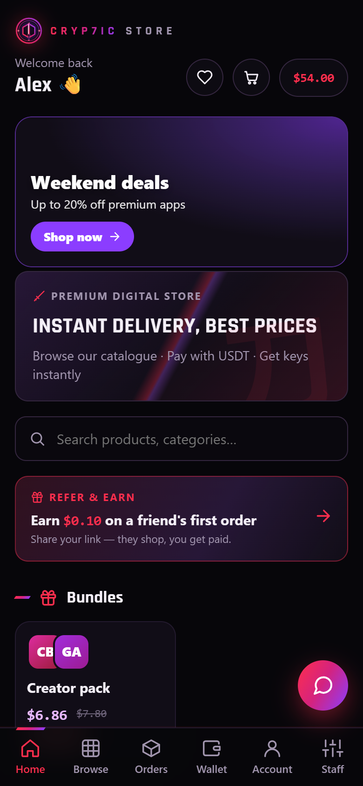
  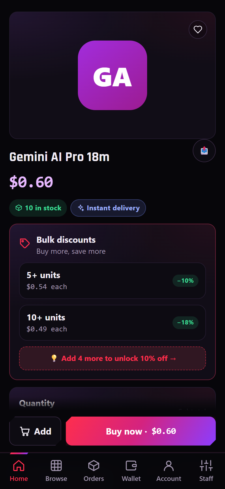
  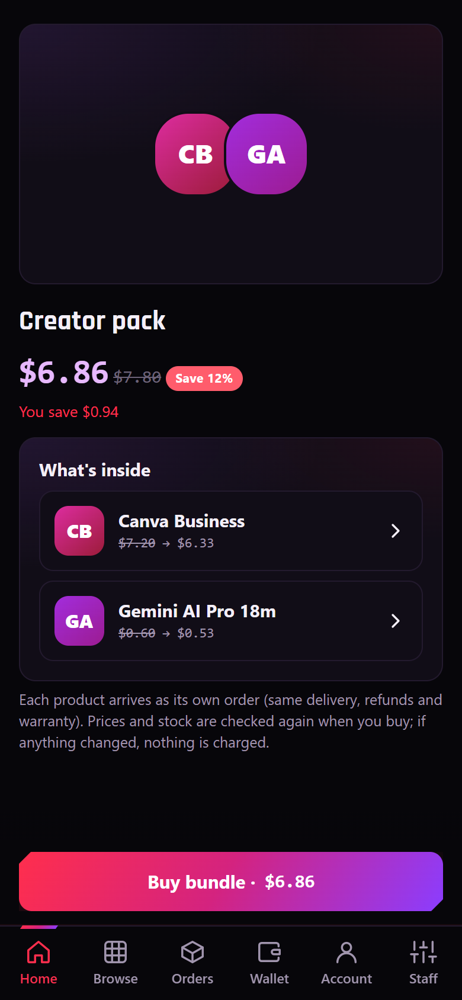
  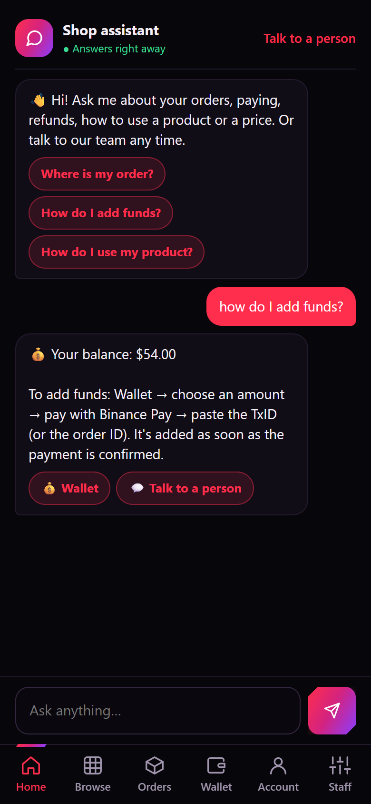
  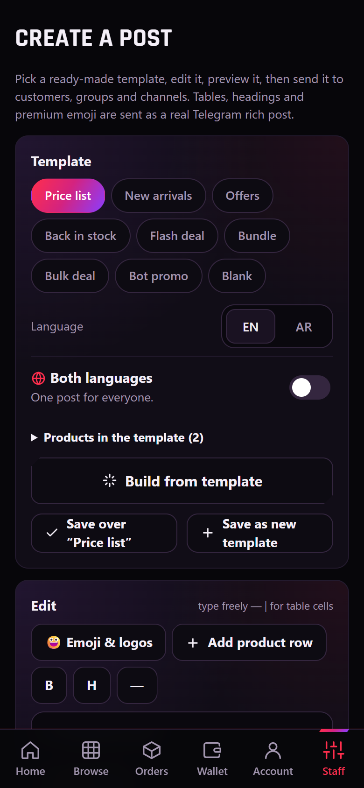
  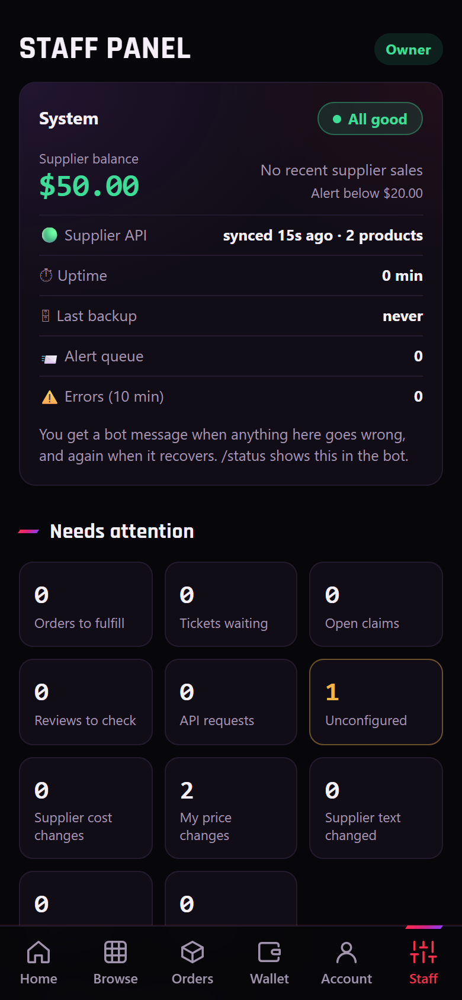

  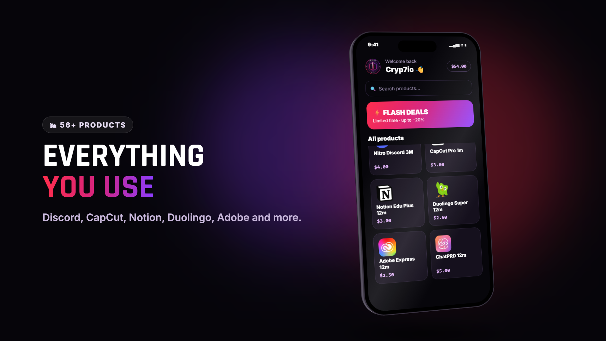
  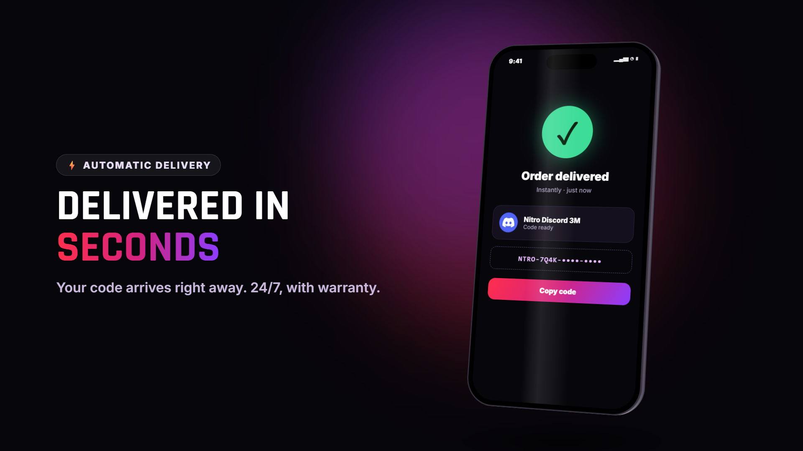
  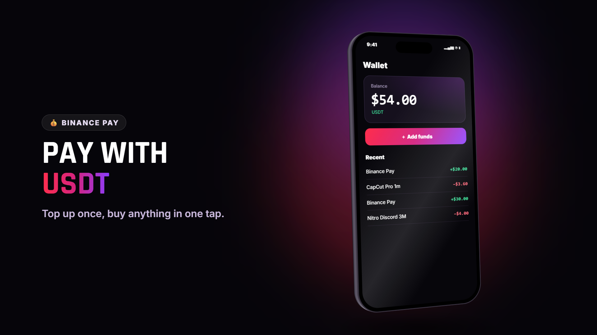

Screenshots use sample data from the test server.

---

## 🇸🇦 متجرك الخاص على تيليجرام

أطلق متجر منتجات رقمية باسمك وشعارك، بدون برمجة:

- بوت تيليجرام خاص بمتجرك على نطاق فرعي خاص بك
- تسليم فوري وتلقائي للأكواد والاشتراكات
- محفظة ودفع عبر Binance Pay (USDT)
- لوحة تحكم للطلبات والمخزون والدعم
- يدعم العربية والإنجليزية

**تواصل معنا على تيليجرام: [@EXModder](https://t.me/EXModder)**

---

Built by <a href="https://github.com/z6il">Abdullah Almuntaser</a> · © 2026 Cryp7ic Store

