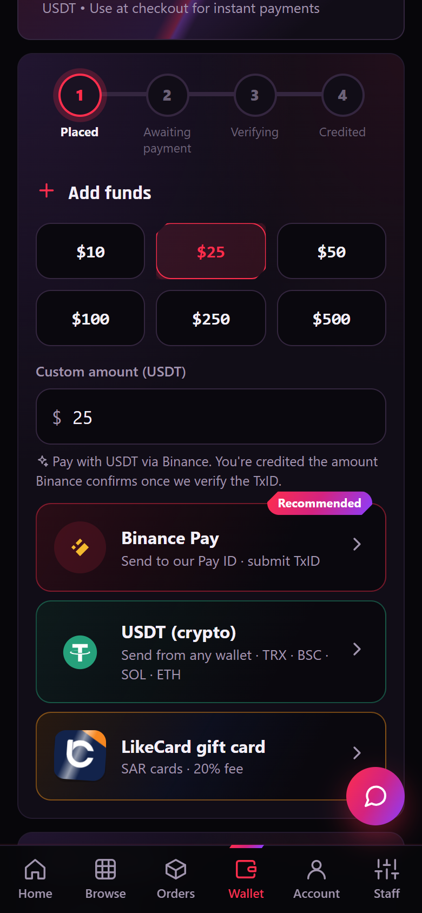
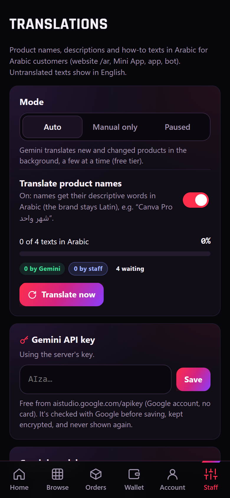
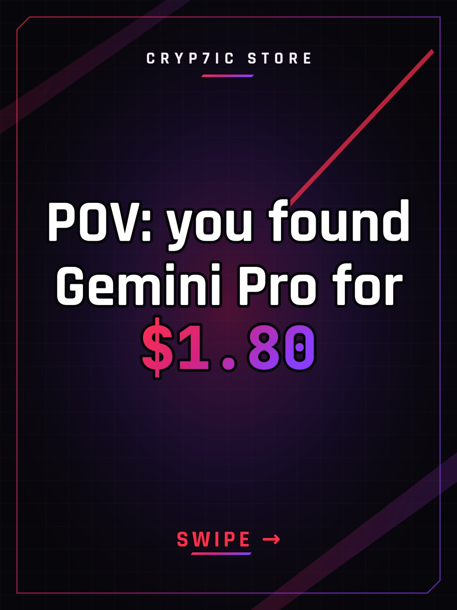
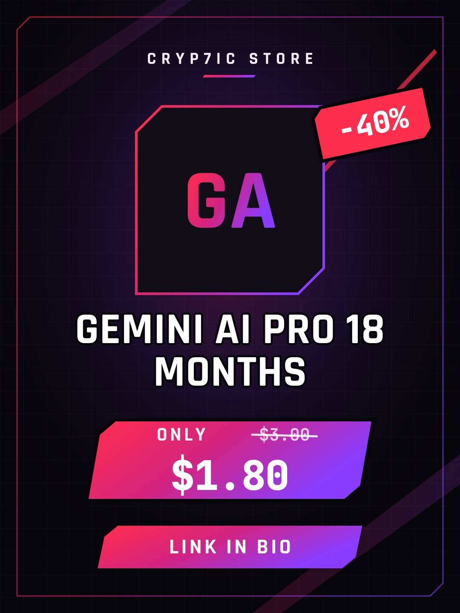
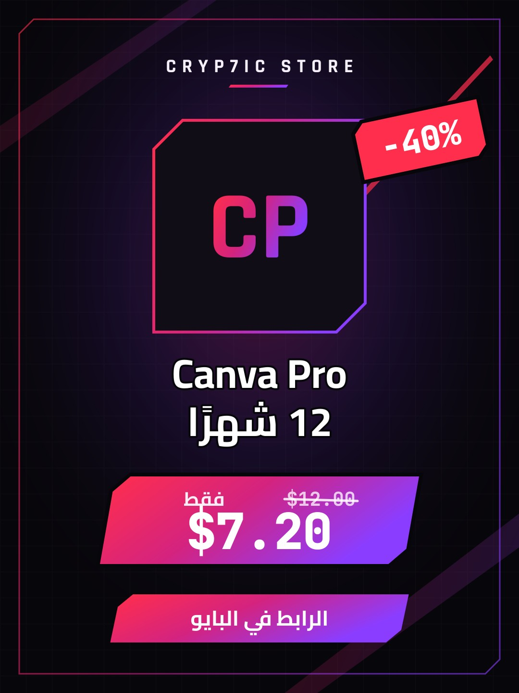
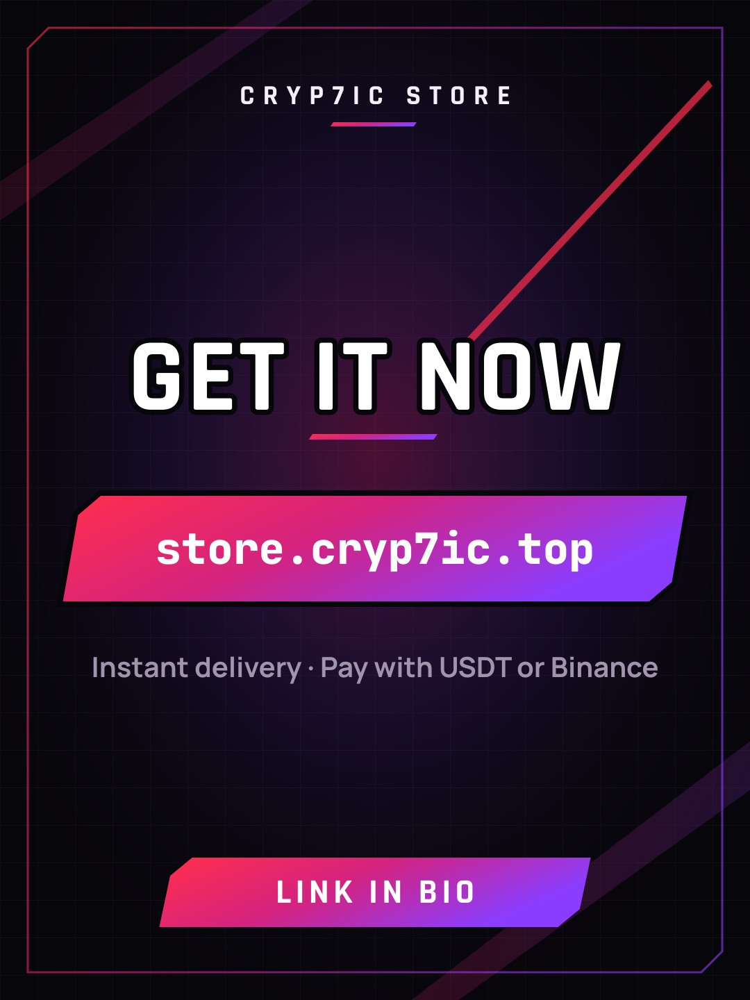

  

  
  

  
  
  
  
  

**Cryp7ic Store** is a production platform for selling digital subscriptions and keys with instant,
automatic delivery. It runs as a Telegram bot, a Telegram Mini App, a website and an Android app,
all on one back end, with a wallet that takes Binance Pay, USDT and gift cards.

**This repo is a showcase.** The source is private. The platform is available to businesses as a
white-label store.

  

---

## 🤝 For businesses: launch your own store

Sell digital products under **your own brand** without building anything.

- 🤖 **Your own Telegram bot store** on your own subdomain, with your name, logo and prices
- 📦 **Ready catalogue** from connected suppliers, delivered automatically to your customers
- 💰 **Wallet with three ways to pay**: Binance Pay, USDT on TRC20 / BEP20 / Solana / Ethereum, and gift cards — every payment verified
- 🛠 **Staff panel** on the web and in the Android app, for orders, stock, tickets and broadcasts
- 🌍 **English and Arabic**, with product texts translated to Arabic automatically
- 📈 **Found on Google and TikTok**: product pages, Google Shopping feed, and auto-made TikTok posts
- 🔌 **Reseller REST API with webhooks** if you'd rather plug into your own system

Plans decide which features each store gets (own products, the shared catalogue, bundles, posts, ads,
the assistant, AI translations, USDT, SEO & Google, TikTok), so you can start small and grow.

  <a href="https://t.me/EXModder"><b>Message @EXModder on Telegram to get started →</b></a> 
  Want to see it first? Try the live store bot: <a href="https://t.me/R9dj_bot">@R9dj_bot</a>

---

## ✨ What's inside

| | |
|---|---|
| ⚡ **Delivery** | Codes delivered from stock or supplier APIs in seconds, with automatic refunds when anything fails |
| 💰 **Wallet** | Binance Pay, USDT deposit addresses on four networks (matched automatically, confirmed on-chain) and gift cards; a full ledger, referrals and VIP cashback levels |
| 🛍 **Shop** | Categories, brand pages, search, bulk-price tiers, bundles, flash deals, pinned products and coupons |
| 🌍 **Two languages** | Every screen in English and Arabic; product names and descriptions translated to Arabic by AI, checked before use, and editable by staff |
| 💬 **Support** | A built-in English/Arabic assistant that answers from the customer's own orders, plus tickets and warranty claims |
| 📣 **Marketing** | Post composer with templates, scheduled announcements, targeted broadcasts, welcome and win-back offers |
| 🎵 **TikTok** | Photo posts made by the shop in its own look: a hook slide, one slide per product with its price, a call to action; AI writes the caption and hashtags |
| 🔎 **SEO** | Public product and brand pages with structured data, sitemap, Google Shopping feed, IndexNow, Search Console and a weekly SEO report |
| 🔔 **Alerts** | Back-in-stock, price drops and new products for customers and channels; new-customer alerts for staff |
| 📱 **Android app** | The full shop, plus the staff panel behind the phone's fingerprint and a sign-in confirmation |
| 🛡 **Security** | Staff sign-ins from the web or the app confirmed in Telegram (or by email), roles, audit log, suspicious-activity alerts |
| 🧰 **Operations** | Health monitoring, daily backups with weekly restore drills, 2,150+ automated checks |

  
  
  
  
  
  
  
  

### 🎵 Made for TikTok, automatically

Pick products, tap "Write it for me", post. The pictures are drawn by the shop in its own look.

  
  
  
  

  
  
  

Screenshots use sample data from the test server.

---

## 🇸🇦 متجرك الخاص على تيليجرام

أطلق متجر منتجات رقمية باسمك وشعارك، بدون برمجة:

- بوت تيليجرام خاص بمتجرك على نطاق فرعي خاص بك
- تسليم فوري وتلقائي للأكواد والاشتراكات
- محفظة بثلاث طرق دفع: Binance Pay، و USDT على أربع شبكات، وبطاقات الهدايا
- لوحة تحكم للطلبات والمخزون والدعم، على الموقع وفي تطبيق Android
- العربية والإنجليزية، مع ترجمة تلقائية لنصوص المنتجات إلى العربية
- يظهر في Google و تيك توك: صفحات منتجات، وتغذية Google Shopping، ومنشورات تيك توك جاهزة

**تواصل معنا على تيليجرام: [@EXModder](https://t.me/EXModder)**

---

Built by <a href="https://github.com/z6il">Abdullah Almuntaser</a> · © 2026 Cryp7ic Store

